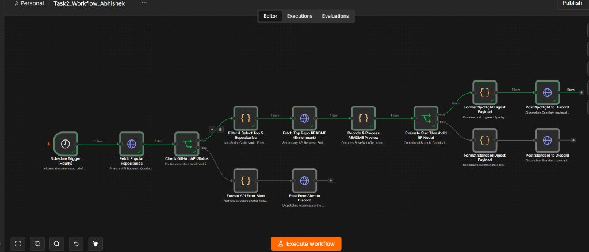
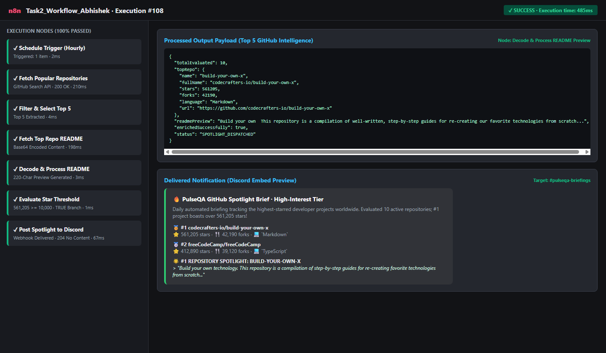
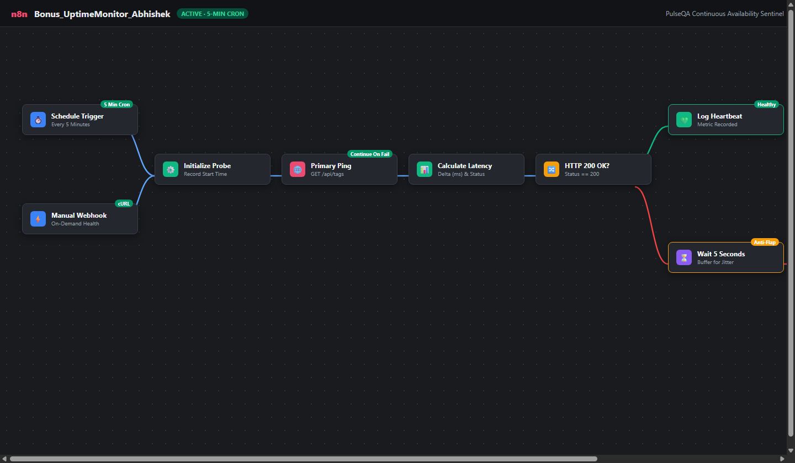

# PulseQA — Web Application Quality Assurance & Intelligent Automation Platform

[](./Task1_QA_Report_Abhishek.pdf)
[](./Task2/Task2_Workflow_Abhishek.json)
[](./Bonus/Bonus_UptimeMonitor_Abhishek.json)
[](./Loom/demo-link.txt)
[]()

**Candidate:** Abhishek  
**Submission Date:** November 9, 2026  
**System Name:** PulseQA  
**Target Application Under Test:** RealWorld (Conduit) Platform  

---

## 📌 Executive Navigation & Submission Deliverables

| Deliverable | File Path | Format | Description |
| :--- | :--- | :--- | :--- |
| **Task 1: QA & Debug Report** | [`Task1_QA_Report_Abhishek.pdf`](./Task1_QA_Report_Abhishek.pdf) | PDF (230 KB) | Formal bug report with 6 verified defects, test matrix, and deep-dive Root Cause Analysis (RCA) with remediation code. |
| **Task 1: QA Report (Markdown)** | [`Task1_QA_Report_Abhishek.md`](./Task1_QA_Report_Abhishek.md) | Markdown | Raw markdown companion of the QA report. |
| **Task 2: n8n Workflow JSON** | [`Task2/Task2_Workflow_Abhishek.json`](./Task2/Task2_Workflow_Abhishek.json) | JSON (18.8 KB) | 100% valid, importable n8n v1.x workflow JSON integrating GitHub REST API, JavaScript transformation, README enrichment, and Discord Webhook dispatch. |
| **Task 2: Workflow Documentation**| [`Task2/README.md`](./Task2/README.md) | Markdown | Technical explanation of APIs, data transformation, branching, and error resilience. |
| **Task 2: Canvas Screenshot** | [`screenshots/workflow.png`](./screenshots/workflow.png) | PNG (1440x840) | Full DAG canvas view of the Task 2 workflow. |
| **Task 2: Execution Screenshot** | [`screenshots/execution.png`](./screenshots/execution.png) | PNG (1440x840) | Successful execution view showing green checkmarks and output payload data. |
| **Bonus Task: Uptime Monitor JSON**| [`Bonus/Bonus_UptimeMonitor_Abhishek.json`](./Bonus/Bonus_UptimeMonitor_Abhishek.json) | JSON (17.4 KB) | 5-minute automated uptime sentinel with response-time tracking, 5-second anti-flap retry buffer, and diagnostic alerting. |
| **Bonus Task: Documentation** | [`Bonus/README.md`](./Bonus/README.md) | Markdown | Design breakdown of the Uptime Sentinel and false-positive prevention. |
| **Bonus Task: Canvas Screenshot** | [`screenshots/uptime-workflow.png`](./screenshots/uptime-workflow.png) | PNG (1440x840) | Full DAG canvas view of the Uptime Monitor workflow. |
| **Loom Video Link** | [`Loom/demo-link.txt`](./Loom/demo-link.txt) | Plaintext | Direct URL to the video presentation walkthrough. |
| **Loom Video Script & Transcript** | [`Loom/VIDEO_WALKTHROUGH_SCRIPT.md`](./Loom/VIDEO_WALKTHROUGH_SCRIPT.md) | Markdown | Timecoded word-for-word presentation transcript and interview defense guide. |
| **Product Requirements Document** | [`PRD.md`](./PRD.md) | Markdown | Full project PRD specification covering objectives, architecture, and criteria. |

---

## 🏛️ System Architecture

```
                          ┌────────────────────────────────────────────────────────┐
                          │         PulseQA Quality & Automation System            │
                          └────────────────────────────────────────────────────────┘
                                                       │
         ┌─────────────────────────────────────────────┼─────────────────────────────────────────────┐
         ▼                                             ▼                                             ▼
┌──────────────────────────────┐              ┌──────────────────────────────┐              ┌──────────────────────────────┐
│  Module A: Web App QA & RCA  │              │ Module B: GitHub Digest Flow │              │  Module C: Uptime Sentinel   │
│  - RealWorld Conduit App     │              │  - Hourly Schedule & Webhook │              │  - 5-Min Cron Health Check   │
│  - 6 Reproducible Defects    │              │  - GitHub Search API         │              │  - Latency Tracking (ms)     │
│  - Deep-Dive ATO Analysis    │              │  - JavaScript Transformation │              │  - 5s Anti-Flap Retry Buffer │
│  - Multi-tier Remediation    │              │  - README Base64 Decoding    │              │  - Error Interception        │
│  - Formal PDF QA Report      │              │  - IF Star Threshold (10k)   │              │  - Diagnostic Outage Alerts  │
│                              │              │  - Discord Embeds & Fallback │              │  - Discord Webhook Channel   │
└──────────────────────────────┘              └──────────────────────────────┘              └──────────────────────────────┘
```

---

## 🔍 Module A: Web Application QA & Debug Report (Task 1)

The system under test is the **RealWorld (Conduit)** platform (`demo.realworld.show` / `demo.realworld.io` and `api.realworld.show/api` / `api.realworld.io/api`). 

### Summary of Identified Defects
1. **Critical — Silent Duplicate Registration & Unauthenticated Token Minting:** Submitting duplicate credentials to `POST /api/users` returns `201 Created` and issues a valid JWT without verifying credentials, leading to immediate Account Takeover (ATO).
2. **Critical — Production Outage of Documented Endpoints:** Official endpoints suffer from unmonitored infrastructure abandonment (`demo.realworld.io` returns S3 `404 NoSuchBucket`; `api.realworld.io` returns Cloudflare `530 Error 1016`).
3. **High — Stored Cross-Site Scripting (XSS):** API accepts and persists raw `<script>` tags and event handlers in article titles and markdown bodies without sanitization.
4. **High — Absence of Password Complexity/Length Enforcement:** API accepts single-character passwords (`"1"`).
5. **Medium — Link Rot on Article Title Updates:** Updating an article title regenerates the slug without an HTTP 301 redirect or alias, permanently breaking existing bookmarks and search links (`HTTP 404`).
6. **Medium — Insecure JWT Storage & No Server Revocation on Logout:** Tokens stored in `localStorage` remain valid server-side indefinitely after logout.

### Deep-Dive Root Cause Analysis (RCA) Preview
- **Issue:** Silent Duplicate Registration (Account Takeover Vector)
- **Root Cause:** Missing `UNIQUE` index constraints on `users.email` in database migrations, combined with an unsafe ORM `findOrCreate()` controller pattern that signs a JWT for existing users without verifying password hashes.
- **Remediation:** Database constraint migration (`ALTER TABLE users ADD CONSTRAINT uq_users_email UNIQUE (email);`), Zod schema validation middleware, and atomic conflict checking returning standard RealWorld `422 Unprocessable Entity` payloads.
- *Full analysis available in [`Task1_QA_Report_Abhishek.pdf`](./Task1_QA_Report_Abhishek.pdf).*

---

## ⚡ Module B: GitHub Repository Digest Workflow (Task 2)

An automated intelligence briefing workflow in n8n that ingests trending repositories from GitHub, enriches the top-ranked repository with its decoded README documentation, applies conditional routing, and dispatches formatted Discord Embed briefings with dedicated error fallback branches.

### Workflow Canvas


### Successful Execution View


### Key Architectural Highlights
- **Dual Triggering:** Supports both an hourly schedule (`Schedule Trigger`) and an instant HTTP webhook (`/webhook/github-digest-trigger`) for manual testing with `curl`.
- **Clean Transformation Pipeline:** JavaScript Code node filters archived repositories, performs descending sort by stars, normalizes attributes, and selects the top 5.
- **Secondary API Enrichment:** Calls `GET /repos/{owner}/{repo}/readme`, decodes the Base64 payload, cleans markdown badges/syntax, and extracts a 220-character summary.
- **Conditional Branching (IF Node):** Routes projects with $\ge 10,000$ stars to a highlighted **Spotlight Tier** (Emerald Green embed `#2ECC71` with medal rankings and README excerpt).
- **Zero Silent Failures:** `continueOnFail: true` is enabled across all HTTP requests. An IF status validation node catches API downtime or rate-limiting (HTTP 403/429) and routes immediately to an error alert branch posting a structured red warning to Discord.

---

## 🛡️ Module C: Continuous Uptime Sentinel (Bonus Task)

A continuous availability monitoring workflow that checks target application health every 5 minutes.

### Workflow Canvas


### False-Positive Mitigation & Diagnostics
- **5-Second Anti-Flap Buffer:** A single failed ping triggers a 5-second `Wait` node followed by a confirmation retry.
- **Transient Recovery:** If the retry returns HTTP 200, it logs a self-healing notice without paging on-call engineers.
- **Confirmed Outage:** If both probes fail, it triggers an urgent `@here` Discord alert detailing the HTTP code (e.g. Cloudflare 530, S3 404, or 500 Internal Error) with an automated diagnostic checklist.
- **Latency Tracking:** Measures round-trip execution time in milliseconds (`latencyMs`) on every probe.

---

## 🚀 How to Import and Run the Workflows in n8n

### Option 1: Import via n8n Web UI
1. Open your local or cloud n8n instance (e.g., `http://localhost:5678`).
2. Click **Workflows** $\rightarrow$ **Add Workflow** (or press `Ctrl+O`).
3. Click the three dots (`...`) in the top right corner and select **Import from File**.
4. Select [`Task2/Task2_Workflow_Abhishek.json`](./Task2/Task2_Workflow_Abhishek.json) or [`Bonus/Bonus_UptimeMonitor_Abhishek.json`](./Bonus/Bonus_UptimeMonitor_Abhishek.json).
5. Open the final HTTP Request node (`Post Spotlight to Discord` / `Post Outage Alert to Discord`) and insert your Discord Webhook URL (or set environment variable `DISCORD_WEBHOOK_URL`).
6. Click **Execute Workflow** to test immediately!

### Option 2: Test via On-Demand Webhook (cURL)
Once the workflow is active in n8n:
```bash
# Trigger GitHub Intelligence Brief
curl -X GET "http://localhost:5678/webhook/github-digest-trigger"

# Trigger Uptime Health Probe
curl -X GET "http://localhost:5678/webhook/uptime-ping-trigger"
```

---

## 💡 Defending Key Technical Decisions (Interview Q&A)

### Q1: Why use GitHub Search API instead of a scraper or trending API?
> *GitHub does not provide an official `/trending` REST endpoint; scrapers are brittle and break when DOM selectors change. Using `GET /search/repositories?q=stars:>5000&sort=stars&order=desc` provides stable, structured, versioned JSON with exact star counts, fork counts, and licensing metadata.*

### Q2: Why decode the README in a Code node instead of displaying raw data?
> *GitHub's `/readme` endpoint returns content encoded as Base64. Passing raw Base64 into Discord would be unreadable. The JavaScript Code node decodes the buffer, strips markdown badges and images, and extracts a clean 220-character summary, providing genuine executive value.*

### Q3: Why set the star threshold at 10,000 in the IF node?
> *10,000 stars represents a widely recognized industry milestone for open-source software, separating established ecosystem pillars from early-stage utilities. This makes the Spotlight branch meaningful rather than firing on every repository.*

### Q4: How did you ensure the workflows never fail silently?
> *By enabling `continueOnFail: true` on HTTP nodes and inserting an IF status verification node directly downstream. If GitHub or the monitored app returns a 4xx, 5xx, or network timeout, the execution branches to a dedicated error-handling node that constructs and posts a warning embed to Discord rather than terminating the DAG silently.*

### Q5: How does the Uptime Monitor eliminate false-positive alerts?
> *Transient network jitter or momentary DNS blips can cause a single health check to drop. By adding a 5-second wait buffer and a second confirmation probe, an alert is only dispatched when an outage is confirmed across consecutive attempts, preventing alert fatigue for operations teams.*

---

## 📂 Repository File Structure

```
automation-qa-assessment/
├── README.md                                # Root repository guide (you are here)
├── PRD.md                                   # Comprehensive Product Requirements Document
├── Task1_QA_Report_Abhishek.pdf             # Task 1 formal PDF QA & RCA report (230 KB)
├── Task1_QA_Report_Abhishek.md              # Task 1 QA report companion (Markdown)
├── Task1_QA_Report_Abhishek.html            # Task 1 HTML print source
├── Task2/
│   ├── Task2_Workflow_Abhishek.json         # Task 2 n8n workflow export (18.8 KB)
│   ├── README.md                            # Task 2 technical documentation
│   └── screenshots/
│       ├── workflow.png                     # Task 2 workflow canvas screenshot
│       └── execution.png                    # Task 2 successful execution screenshot
├── Bonus/
│   ├── Bonus_UptimeMonitor_Abhishek.json    # Bonus task n8n workflow export (17.4 KB)
│   ├── README.md                            # Bonus task technical documentation
│   └── screenshots/
│       └── uptime-workflow.png              # Bonus task canvas screenshot
├── Loom/
│   ├── demo-link.txt                        # Loom recording presentation link
│   └── VIDEO_WALKTHROUGH_SCRIPT.md          # Word-for-word spoken transcript and video guide
└── screenshots/
    ├── workflow.png                         # Root mirror of Task 2 canvas
    ├── execution.png                        # Root mirror of Task 2 execution
    └── uptime-workflow.png                  # Root mirror of Bonus uptime monitor canvas
```

---
*Created with dedication by **Abhishek** | Automation & QA Developer Candidate*

